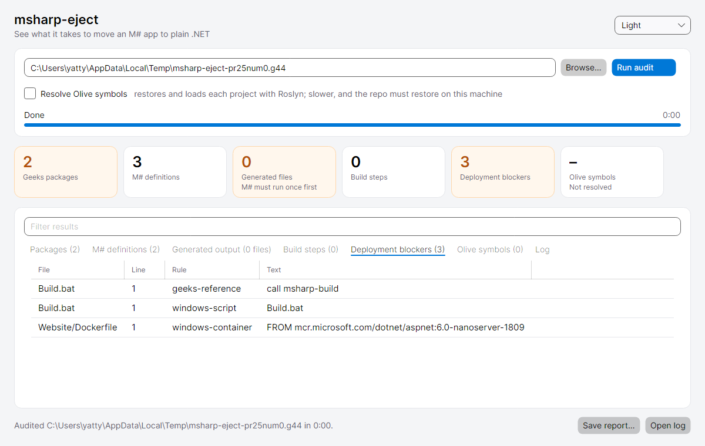

# msharp-eject

Move an [M#](https://github.com/Geeksltd/MSharp.Docs) application off M# and the [Olive](https://github.com/Geeksltd/Olive) framework, so it becomes an ordinary ASP.NET Core app that builds and deploys on any OS or cloud.

> **Status: early.** Only `audit` works today, from the desktop app or the command line. `eject` (remove M#) and `de-olive` (remove Olive) are planned; see [docs/plan.md](docs/plan.md).
>
> Not affiliated with or endorsed by Geeks Ltd. M# and Olive are their products.

## Why

An M# solution keeps its entity and UI definitions in a C# DSL (`M#/Model`, `M#/UI`). At build time a closed-source generator turns them into the entities, data access, controllers and Razor views the app actually runs. That generated code is gitignored, so it never reaches source control.

This causes three problems:

- **The build only works on Windows.** The generator hard-codes `C:\Program Files\dotnet\dotnet.exe` and backslash paths, and the template's build runs `.bat` files and a Windows-only Sass compiler.
- **The app depends on Olive at runtime.** The generated code is built on Olive's entity, data-access and MVC layers, plus the Olive.MvcJs front end. Olive is GPL v3 unless you buy a commercial licence.
- **The code you deploy isn't the code you review**, because the real C# only exists after a build.

`msharp-eject` is meant to be run **once** per repo. Its end state is plain C# and Razor in git, with no Geeks packages, tools or build steps, which builds and deploys on Linux, macOS, Windows or any container platform. The repo's own tests must still pass.

## How it works

The work is done in three passes, each safe to review on its own:

| Command | What it does | Status |
|---|---|---|
| `audit` | Read-only report: Geeks packages, M# definitions, generated output, Windows-only build steps, deployment blockers, and every Olive symbol the code uses | ✅ |
| `eject` | Commits M#'s final generated output as source, deletes the `M#` folder and `MSharp` package, and replaces Windows-only build steps | planned |
| `de-olive` | Roslyn codemods that replace Olive with the .NET base library, ASP.NET Core and EF Core (mapped onto your existing database schema) | planned |

Source generators are deliberately not used. M# definitions have to be *run* to mean anything, and a generator would add a permanent build dependency, which defeats the point. [docs/plan.md](docs/plan.md) covers the reasoning and the research behind it.

## Requirements

- The [.NET 10 SDK](https://dotnet.microsoft.com/download) on Windows, Linux or macOS. Even the self-contained downloads need it for the full audit, because Roslyn loads projects through the SDK's MSBuild.
- For the full audit, the target repo must restore (`dotnet restore`) on your machine. That means access to the Olive packages on nuget.org and to any private feeds it uses. Older M# repos target `net6.0`, so you may also need that targeting pack.

## Download

Each [release](../../releases) has a self-contained build per platform: `win-x64`, `linux-x64`, `osx-x64` and `osx-arm64`. Each one contains two programs:

| File | What it is |
|---|---|
| `msharp-eject-gui` (`.exe` on Windows) | Desktop app |
| `MSharpEject` (`.exe` on Windows) | Command line |

Keep the `BuildHost-*` folders next to the executables. Roslyn starts them as separate processes.

- **macOS:** the builds aren't signed. After unpacking, run `xattr -dr com.apple.quarantine <folder>`, then start the app from Terminal.
- **Linux:** the desktop app needs X11 or XWayland, plus `libICE`, `libSM` and `fontconfig`. Desktop distros already have these.

## Desktop app

<picture>
  <source media="(prefers-color-scheme: dark)" srcset="docs/images/gui-dark.png">
  
</picture>

1. Choose a repository. The audit starts straight away.
2. A progress bar shows the current step: listing files, restoring each project, loading it into Roslyn, resolving symbols.
3. **Cancel** stops the audit at any point, including a restore stuck on an unreachable feed.
4. The tiles summarise the result, and amber means something needs attention. The tabs hold the detail.
5. **Filter** narrows every tab at once. Double-click a build step or blocker to open that file.
6. **Save report…** writes the same markdown the command line produces.
7. **Open log** shows the full log of the run (see [Logs](#logs)).

The theme follows your system by default. You can switch it to Light or Dark in the top right, and the choice is remembered.

## Command line

From a release:

```bash
./MSharpEject audit path/to/your-msharp-repo --out audit.md
```

From source:

```bash
dotnet run --project src/MSharpEject -- audit path/to/your-msharp-repo --out audit.md
```

| Option | Meaning |
|---|---|
| `--out <file>` | Write the markdown report to a file instead of stdout |
| `--log <file>` | Write the run log here instead of the default location |
| `--no-semantic` | Skip restoring and loading projects with Roslyn. File scans only, so much faster, but there's no Olive symbol table |

Progress goes to stderr (`[ 40%] Loading Domain/Domain.csproj (1/3)`), so stdout carries only the report. Ctrl+C cancels.

| Exit code | Meaning |
|---|---|
| `0` | Success |
| `1` | Bad arguments |
| `2` | Failed (see the log) |
| `130` | Cancelled |

The full audit runs `dotnet restore` on each non-M# project and loads it with Roslyn's `MSBuildWorkspace`. Apart from what `dotnet restore` creates in `obj/`, it writes nothing into your repo.

[docs/audit.md](docs/audit.md) explains every section and finding in the report and what to do about it.

## Logs

Every run, from the app or the command line, writes a full log, even if it fails or is killed partway through. A run that doesn't finish, or produces surprising numbers, can be diagnosed from the log alone.

| OS | Folder |
|---|---|
| Windows | `%LOCALAPPDATA%\msharp-eject\logs` |
| Linux | `~/.local/share/msharp-eject/logs` |
| macOS | `~/Library/Application Support/msharp-eject/logs` |

The command line prints the exact path when it starts, and the app's **Open log** button opens it.

It records:

- tool version and commit, OS, .NET runtime, command line
- `dotnet --info`, i.e. which SDKs MSBuild could use
- every external command with its exit code and complete stdout/stderr (each `dotnet restore`)
- every Roslyn workspace diagnostic, and each project's file count, reference count and first 100 compile errors
- how long each step took
- any exception, with its full stack trace

Compile errors are normal while M#'s generated code is missing, because hand-written partial classes refer to generated members. The audit still resolves Olive symbols in that state.

### Reporting a problem

Open an issue using the bug report template, with the log attached. Check the log first: it contains paths from your machine, plus the restore output for your repo, which can name private feeds.

## Development

```bash
dotnet test
```

Tests use [TUnit](https://tunit.dev) on Microsoft.Testing.Platform (configured in `global.json`). They cover:

- unit tests for each scanner, with real csproj and source snippets from M# projects
- Olive symbol resolution against an in-memory fake `Olive` assembly
- an end-to-end audit of a small fake M# repo, which loads real projects through `MSBuildWorkspace`, including restore failures, progress and cancellation
- the run log and the process runner (output capture, killing on cancel)
- the desktop app, run headlessly through Avalonia: workflow, filtering, theme persistence, and a rendered screenshot in light and dark (written to `tests/MSharpEject.Tests/bin/Debug/net10.0/TestResults/`)

CI runs the suite on Ubuntu, Windows and macOS. Pushing a `v*` tag runs the release workflow: it tests, publishes the four self-contained builds and creates the GitHub release.

Layout:

```
src/MSharpEject/             command line and core
  Program.cs                 command-line entry
  RunLog.cs                  run log file and progress events
  ProcessRunner.cs           runs external commands, logs their output, kills on cancel
  Audit/RepoScan.cs          file-level scans (csproj, package.json, DSL, blockers)
  Audit/OliveUsage.cs        Roslyn pass that counts Olive symbols
  Audit/Auditor.cs           runs the scans, reports progress, renders the markdown report
src/MSharpEject.Gui/         Avalonia desktop app
  MainWindow.axaml(.cs)      the window
  ResultView.cs              stat tiles, filtering, tab headers
  ThemeSetting.cs            System/Light/Dark preference
src/Directory.Build.targets  keeps Roslyn's BuildHost out of single-file bundles
tests/MSharpEject.Tests/     TUnit tests
docs/                     plan and reference docs
```

Contributions are welcome. Audit output from real M# repos (with anything private stripped) is the most useful input right now: it shows which Olive APIs the codemods need to cover first.

Olive is GPL v3, so don't copy its source into this repo or into code the tool generates. Write replacements from documented behaviour.

## License

[MIT](LICENSE)
