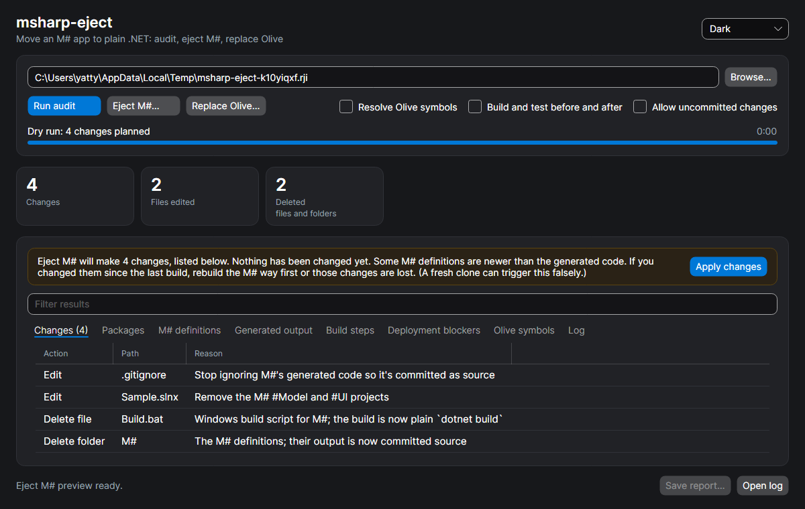

# msharp-eject

Move an [M#](https://github.com/Geeksltd/MSharp.Docs) application off M# and the [Olive](https://github.com/Geeksltd/Olive) framework, so it becomes an ordinary ASP.NET Core app that builds and deploys on any OS or cloud.

> **Status: pre-release.** `audit` and `eject` are complete. `de-olive` handles the first set of rewrites: Olive calls with an exact .NET equivalent. Replacing Olive's data, MVC and front-end layers is the next phase; see [Status](#status).
>
> Not affiliated with or endorsed by Geeks Ltd. M# and Olive are their products.

## Why

An M# solution keeps its entity and UI definitions in a C# DSL (`M#/Model`, `M#/UI`). At build time a closed-source generator turns them into the entities, data access, controllers and Razor views the app actually runs. That generated code is gitignored, so it never reaches source control.

This causes three problems:

- **The build only works on Windows.** The generator hard-codes `C:\Program Files\dotnet\dotnet.exe` and backslash paths, and the template's build runs `.bat` files and a Windows-only Sass compiler.
- **The app depends on Olive at runtime.** The generated code is built on Olive's entity, data-access and MVC layers, plus the Olive.MvcJs front end. Olive is GPL v3 unless you buy a commercial licence.
- **The code you deploy isn't the code you review**, because the real C# only exists after a build.

`msharp-eject` is meant to be run **once** per repo. Its end state is plain C# and Razor in git, with no Geeks packages, tools or build steps, which builds and deploys on Linux, macOS, Windows or any container platform. The repo's own tests must still pass.

## How it works

There are three steps. Each can be reviewed on its own, and each is a separate commit in your repo:

| Step | What it does | Reference |
|---|---|---|
| **Audit** | Read-only report: Geeks packages, M# definitions, generated output, Windows-only build steps, deployment blockers, and every Olive symbol the code uses | [docs/audit.md](docs/audit.md) |
| **Eject M#** | Commits M#'s generated code as source, deletes `M#/`, removes the projects from the solution, replaces the Windows-only Sass/WebCompiler build, modernises Dockerfiles | [docs/eject.md](docs/eject.md) |
| **Replace Olive** | Roslyn rewrites that swap Olive calls for .NET equivalents, verified to behave identically | [docs/de-olive.md](docs/de-olive.md) |

Eject and Replace Olive share one safety model:

1. **Preview first.** Every change is listed before anything is touched (`--dry-run` on the command line).
2. **A clean git tree is required**, so each change can be reviewed with `git diff` and undone with `git checkout -- .`.
3. **Verified against a baseline.** The repo is built and tested *before* the change and again *after*. Only new failures count against the tool, so tests that already failed don't block it.

Source generators are deliberately not used. M# definitions have to be *run* to mean anything, and a generator would add a permanent build dependency, which defeats the point. [docs/plan.md](docs/plan.md) covers the reasoning and the research behind it.

## Requirements

- The [.NET 10 SDK](https://dotnet.microsoft.com/download) on Windows, Linux or macOS. Even the self-contained downloads need it, because Roslyn loads projects through the SDK's MSBuild, and verification runs `dotnet build` and `dotnet test`.
- The target repo must restore (`dotnet restore`) on your machine. That means access to the Olive packages on nuget.org and to any private feeds it uses. Older M# repos target `net6.0`, so you may also need that targeting pack.
- `git`, for eject and Replace Olive.
- Node.js, to build an ejected web project: Sass, TypeScript and front-end packages are compiled with npm tools.

## Download

Each [release](../../releases) has a self-contained build per platform: `win-x64`, `linux-x64`, `osx-x64` and `osx-arm64`. Each one contains two programs:

| File | What it is |
|---|---|
| `msharp-eject-gui` (`.exe` on Windows) | Desktop app |
| `MSharpEject` (`.exe` on Windows) | Command line |

Keep the `BuildHost-*` folders next to the executables. Roslyn starts them as separate processes.

- **macOS:** the builds aren't signed. After unpacking, run `xattr -dr com.apple.quarantine <folder>`, then start the app from Terminal.
- **Linux:** the desktop app needs X11 or XWayland, plus `libICE`, `libSM` and `fontconfig`. Desktop distros already have these.

The command line is also published as a .NET tool:

```bash
dotnet tool install --global msharp-eject
```

## Desktop app

<picture>
  <source media="(prefers-color-scheme: dark)" srcset="docs/images/gui-dark.png">
  
</picture>

1. Choose a repository. The audit starts straight away.
2. A progress bar shows the current step: restoring, loading into Roslyn, resolving symbols, building, testing.
3. **Cancel** stops any step, including a restore stuck on an unreachable feed.
4. The tiles summarise the result, and amber means something needs attention. The tabs hold the detail.
5. **Eject M#…** and **Replace Olive…** show a preview: a banner, plus a **Changes** tab listing every edit and deletion. Nothing is touched until you press **Apply changes**.

   

6. After an apply, the banner shows the verification result (build, and tests before and after), and the audit re-runs so you can see what's left.
7. **Filter** narrows every tab at once. Double-click a change, build step or blocker to open that file.
8. **Save report…** writes the audit as markdown. **Open log** shows the full log of the last run (see [Logs](#logs)).

The options next to the buttons:

- **Resolve Olive symbols:** whether the audit loads projects with Roslyn.
- **Build and test before and after:** whether changes are verified.
- **Allow uncommitted changes:** apply even when the git tree is dirty.

The theme follows your system by default. You can switch it to Light or Dark in the top right, and the choice is remembered. The UI never blocks: all work runs in the background, and log and progress updates are batched.

## Command line

```bash
msharp-eject audit    path/to/repo [--out audit.md] [--no-semantic]
```

```bash
msharp-eject eject    path/to/repo [--dry-run] [--allow-dirty] [--no-verify] [--generate]
```

```bash
msharp-eject de-olive path/to/repo [--dry-run] [--allow-dirty] [--no-verify]
```

From source, use `dotnet run --project src/MSharpEject -- <command> ...`.

| Option | Meaning |
|---|---|
| `--out <file>` | Audit: write the markdown report to a file instead of stdout |
| `--no-semantic` | Audit: file scans only, with no Roslyn pass. Much faster, but there's no Olive symbol table |
| `--dry-run` | List the changes without making them |
| `--allow-dirty` | Run even with uncommitted changes |
| `--no-verify` | Skip building and testing before and after |
| `--generate` | Eject: run M# once first, to produce the generated code (Windows only) |
| `--log <file>` | Write the run log here instead of the default location |

Progress goes to stderr (`[ 40%] Loading Domain/Domain.csproj`), so stdout carries only the report. Ctrl+C cancels.

| Exit code | Meaning |
|---|---|
| `0` | Success |
| `1` | Bad arguments |
| `2` | Failed (see the log) |
| `3` | The change can't run, or verification found a problem (the output says which) |
| `130` | Cancelled |

## Logs

Every run, from the app or the command line, writes a full log, even if it fails or is killed partway through. A run that doesn't finish, or produces surprising numbers, can be diagnosed from the log alone.

| OS | Folder |
|---|---|
| Windows | `%LOCALAPPDATA%\msharp-eject\logs` |
| Linux | `~/.local/share/msharp-eject/logs` |
| macOS | `~/Library/Application Support/msharp-eject/logs` |

The command line prints the exact path when it starts, and the app's **Open log** button opens it.

It records:

- tool version and commit, OS, .NET runtime, command line
- `dotnet --info`, i.e. which SDKs MSBuild could use
- every external command with its exit code and complete stdout/stderr (each `dotnet restore`)
- every Roslyn workspace diagnostic, and each project's file count, reference count and first 100 compile errors
- how long each step took
- any exception, with its full stack trace

Compile errors are normal while M#'s generated code is missing, because hand-written partial classes refer to generated members. The audit still resolves Olive symbols in that state.

### Reporting a problem

Open an issue using the bug report template, with the log attached. Check the log first: it contains paths from your machine, plus the restore output for your repo, which can name private feeds.

## Development

```bash
dotnet test
```

Tests use [TUnit](https://tunit.dev) on Microsoft.Testing.Platform (configured in `global.json`). They cover:

- unit tests for each scanner, with real csproj and source snippets from M# projects
- Olive symbol resolution against an in-memory fake `Olive` assembly
- an end-to-end audit of a small fake M# repo, which loads real projects through `MSBuildWorkspace`, including restore failures, progress and cancellation
- the run log and the process runner (output capture, killing on cancel)
- eject transforms (gitignore, sln/slnx, csproj, Dockerfile, tool manifest), each idempotent, with exact expected output
- eject and Replace Olive end to end on a fake M# solution with git and an MSTest suite, building and testing before and after
- each Replace Olive rewrite, plus a test that compiles and runs original and rewritten code on null, empty and normal inputs and compares the results
- the desktop app, run headlessly through Avalonia: audit, preview, apply, filtering, theme persistence, and rendered screenshots (written to `tests/MSharpEject.Tests/bin/Debug/net10.0/TestResults/`)

CI runs the suite on Ubuntu, Windows and macOS. Pushing a `v*` tag runs the release workflow: it tests, publishes the four self-contained builds and creates the GitHub release.

Layout:

```
src/MSharpEject/             command line and core
  Program.cs                 command-line entry
  RunLog.cs                  run log file and progress events
  ProcessRunner.cs           runs external commands, logs their output, kills on cancel
  Audit/RepoScan.cs          file-level scans (csproj, package.json, DSL, blockers)
  Audit/OliveUsage.cs        Roslyn pass that counts Olive symbols
  Audit/Auditor.cs           runs the scans, reports progress, renders the markdown report
  ProjectLoader.cs           one restore and solution load, parallel compilation
  Verifier.cs                build and test, TRX parsing, before/after comparison
  Git.cs                     clean-tree check
  FileText.cs                reads and writes files keeping BOM and line endings
  Eject/                     eject planner, pure transforms, change applier, report text
  DeOlive/                   BCL rules, Roslyn rewriter, de-olive runner
src/MSharpEject.Gui/         Avalonia desktop app
  MainWindow.axaml(.cs)      the window
  ResultView.cs              stat tiles, filtering, tab headers
  ThemeSetting.cs            System/Light/Dark preference
src/Directory.Build.targets  keeps Roslyn's BuildHost out of single-file bundles
tests/MSharpEject.Tests/     TUnit tests
docs/                     plan and reference docs
```

Contributions are welcome. Audit output from real M# repos (with anything private stripped) is the most useful input right now: it shows which Olive APIs the codemods need to cover first.

Olive is GPL v3, so don't copy its source into this repo or into code the tool generates. Write replacements from documented behaviour.

## Status

| Area | State |
|---|---|
| Audit | Complete |
| Eject M# | Complete. Tested end to end on generated fixtures. `--generate` needs Windows and a real M# install, and isn't covered by CI. |
| Replace Olive: .NET equivalents | 7 rewrites: `HasValue`, `IsEmpty`, `OrEmpty`, `HasAny`, `None` (2 overloads), `Lacks` |
| Replace Olive: more core extensions | Next: picked from audits of real repos |
| Replace Olive: data layer to EF Core with migrations | Planned ([docs/plan.md](docs/plan.md)) |
| Replace Olive: MVC layer and Olive.MvcJs front end | Planned |
| Replace Olive: Audit, CSV, Export, PDF, Hangfire, Email, Security | Planned |
| Remove Olive package references once unused | Planned |

Audit output from real M# repos decides what comes next. Please share yours, with anything private stripped.

## License

[MIT](LICENSE)
